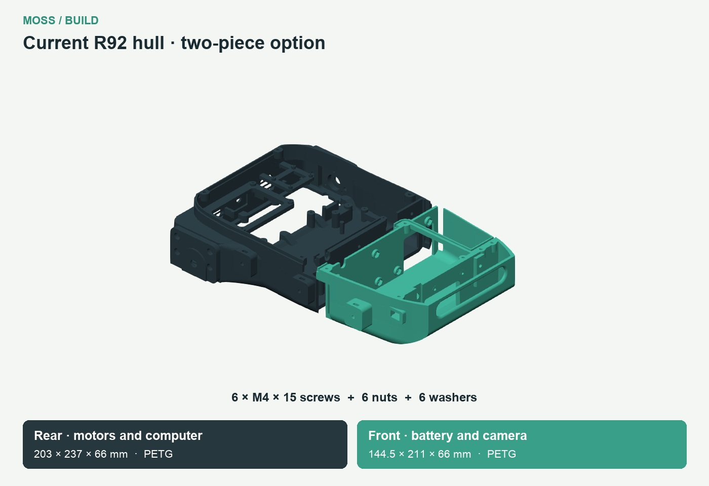
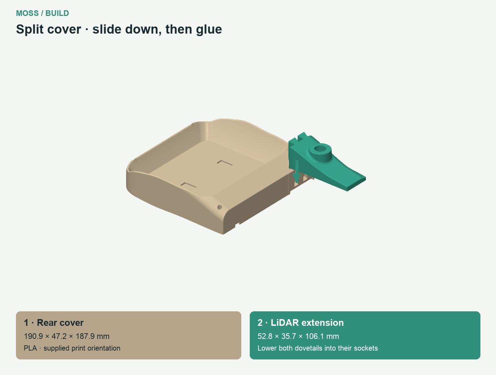

# Assembly guide

Prepare the parts and fasteners for one step, then watch its short clip. Quantities are for one rover unless the text says per wheel. Computer and camera alternatives must not be added together.

Seven coordinated clips cover part identification, five exploded assemblies and road-wheel fastening. Use the [reference list](PART_REFERENCES.md) to match every spacer and shaft collar.

## 01. Choose the hull and fit the inserts

| Prepare | Quantity |
|---|---:|
| [Hull_R92](https://github.com/metrox-eth/moss/releases/download/v0.6-r92/Hull_R92.stl) · PETG | 1 |
| [Lidar_Base_R84](https://github.com/metrox-eth/moss/releases/download/v0.6-r92/Lidar_Base_R84.stl) · PETG | 1 |
| [Hull_R92_Split_Rear_Motor_Computer](https://github.com/metrox-eth/moss/releases/download/v0.6-r92/Hull_R92_Split_Rear_Motor_Computer.stl) · PETG | 1 |
| [Hull_R92_Split_Front_Battery_Camera](https://github.com/metrox-eth/moss/releases/download/v0.6-r92/Hull_R92_Split_Front_Battery_Camera.stl) · PETG | 1 |
| Epoxy from the two-part kit, for the hull joint | As needed |
| M3 heat-set insert, OD4 mm, length 6 mm | 11 |
| Split hull only: M4 × 15 socket-head screw | 6 |
| Split hull only: M4 hex nut, 7 mm across flats | 6 |
| Split hull only: M4 washer, Ø9 × 0.8 mm | 6 |

1. Choose the one-piece hull or both split halves. For the split hull, dry-fit both halves first, then apply a thin layer of two-part epoxy to the mating faces. Engage the locating pins, seat six nuts from the battery side, and fit six M4 × 15 screws with washers from the motor/computer side. Tighten progressively and let the epoxy cure before installing electronics or the battery.
2. Use a soldering iron to fit the inserts: place each insert over its hole, heat it with the iron tip, then gently press it straight into the plastic. Fit four inserts for the cover, four for the arm plate and two for the LiDAR base in the hull.
3. Use the same soldering-iron method to fit the remaining insert in the LiDAR base for the carriage lock. Keep the threads clear and let all inserts cool before fitting screws.

## 02. Build the six road wheels

| Prepare | Quantity |
|---|---:|
| [Left_625_road_wheel_-70_inner_half_R13](https://github.com/metrox-eth/moss/releases/download/v0.6-r92/Left_625_road_wheel_-70_inner_half_R13.stl) · PETG | 1 |
| [Left_625_road_wheel_-70_outer_half_R13](https://github.com/metrox-eth/moss/releases/download/v0.6-r92/Left_625_road_wheel_-70_outer_half_R13.stl) · PETG | 1 |
| [Left_625_road_wheel_70_inner_half_R13](https://github.com/metrox-eth/moss/releases/download/v0.6-r92/Left_625_road_wheel_70_inner_half_R13.stl) · PETG | 1 |
| [Left_625_road_wheel_70_outer_half_R13](https://github.com/metrox-eth/moss/releases/download/v0.6-r92/Left_625_road_wheel_70_outer_half_R13.stl) · PETG | 1 |
| [Right_625_road_wheel_-70_inner_half_R13](https://github.com/metrox-eth/moss/releases/download/v0.6-r92/Right_625_road_wheel_-70_inner_half_R13.stl) · PETG | 1 |
| [Right_625_road_wheel_-70_outer_half_R13](https://github.com/metrox-eth/moss/releases/download/v0.6-r92/Right_625_road_wheel_-70_outer_half_R13.stl) · PETG | 1 |
| [Right_625_road_wheel_70_inner_half_R13](https://github.com/metrox-eth/moss/releases/download/v0.6-r92/Right_625_road_wheel_70_inner_half_R13.stl) · PETG | 1 |
| [Right_625_road_wheel_70_outer_half_R13](https://github.com/metrox-eth/moss/releases/download/v0.6-r92/Right_625_road_wheel_70_outer_half_R13.stl) · PETG | 1 |
| [Left_625_road_wheel_0_inner_half_R13](https://github.com/metrox-eth/moss/releases/download/v0.6-r92/Left_625_road_wheel_0_inner_half_R13.stl) · PETG | 1 |
| [Left_625_road_wheel_0_outer_half_R13](https://github.com/metrox-eth/moss/releases/download/v0.6-r92/Left_625_road_wheel_0_outer_half_R13.stl) · PETG | 1 |
| [Right_625_road_wheel_0_inner_half_R13](https://github.com/metrox-eth/moss/releases/download/v0.6-r92/Right_625_road_wheel_0_inner_half_R13.stl) · PETG | 1 |
| [Right_625_road_wheel_0_outer_half_R13](https://github.com/metrox-eth/moss/releases/download/v0.6-r92/Right_625_road_wheel_0_outer_half_R13.stl) · PETG | 1 |
| [SP09 · Left_Spacer_road_wheel_-70_center](https://github.com/metrox-eth/moss/releases/download/v0.6-r92/Left_Spacer_road_wheel_-70_center.stl) · PETG | 1 |
| [SP09 · Left_Spacer_road_wheel_0_center](https://github.com/metrox-eth/moss/releases/download/v0.6-r92/Left_Spacer_road_wheel_0_center.stl) · PETG | 1 |
| [SP09 · Left_Spacer_road_wheel_70_center](https://github.com/metrox-eth/moss/releases/download/v0.6-r92/Left_Spacer_road_wheel_70_center.stl) · PETG | 1 |
| [SP09 · Right_Spacer_road_wheel_-70_center](https://github.com/metrox-eth/moss/releases/download/v0.6-r92/Right_Spacer_road_wheel_-70_center.stl) · PETG | 1 |
| [SP09 · Right_Spacer_road_wheel_0_center](https://github.com/metrox-eth/moss/releases/download/v0.6-r92/Right_Spacer_road_wheel_0_center.stl) · PETG | 1 |
| [SP09 · Right_Spacer_road_wheel_70_center](https://github.com/metrox-eth/moss/releases/download/v0.6-r92/Right_Spacer_road_wheel_70_center.stl) · PETG | 1 |
| 625 bearing | 12 |
| M3 × 35 socket-head screw | 18 |
| M3 hex nut | 18 |

1. For each wheel, prepare two printed halves, one SP09 centre spacer, two 625 bearings, three M3 × 35 screws and three M3 nuts.
2. Insert each bearing through the open mating face of its wheel half. Do not push it through the smaller outside opening.
3. Seat the three nuts in the inner half, position SP09 between the bearings, close the wheel halves, then insert the three screws from the outer face. Repeat six times.

[Watch the fastening example](videos/06-road-wheel-screws.mp4)

## 03. Build the two drive wheels

| Prepare | Quantity |
|---|---:|
| [Left_HEX12_drive_wheel_inner_half_R13](https://github.com/metrox-eth/moss/releases/download/v0.6-r92/Left_HEX12_drive_wheel_inner_half_R13.stl) · PETG | 1 |
| [Left_HEX12_drive_wheel_outer_half_R13](https://github.com/metrox-eth/moss/releases/download/v0.6-r92/Left_HEX12_drive_wheel_outer_half_R13.stl) · PETG | 1 |
| [Right_HEX12_drive_wheel_inner_half_R13](https://github.com/metrox-eth/moss/releases/download/v0.6-r92/Right_HEX12_drive_wheel_inner_half_R13.stl) · PETG | 1 |
| [Right_HEX12_drive_wheel_outer_half_R13](https://github.com/metrox-eth/moss/releases/download/v0.6-r92/Right_HEX12_drive_wheel_outer_half_R13.stl) · PETG | 1 |
| HEX12 metal hub, 6 mm bore, 18 mm length | 2 |
| M3 × 20 socket-head screw | 6 |
| M3 hex nut | 6 |

1. Match the locating feature on each pair of halves.
2. Close each wheel with three M3 × 20 screws and three M3 nuts. Keep the HEX12 seat clear.

## 04. Build the two idler wheels

| Prepare | Quantity |
|---|---:|
| [Left_22T_idler_wheel_inner_half_R13](https://github.com/metrox-eth/moss/releases/download/v0.6-r92/Left_22T_idler_wheel_inner_half_R13.stl) · PETG | 1 |
| [Left_22T_idler_wheel_outer_half_R13](https://github.com/metrox-eth/moss/releases/download/v0.6-r92/Left_22T_idler_wheel_outer_half_R13.stl) · PETG | 1 |
| [Right_22T_idler_wheel_inner_half_R13](https://github.com/metrox-eth/moss/releases/download/v0.6-r92/Right_22T_idler_wheel_inner_half_R13.stl) · PETG | 1 |
| [Right_22T_idler_wheel_outer_half_R13](https://github.com/metrox-eth/moss/releases/download/v0.6-r92/Right_22T_idler_wheel_outer_half_R13.stl) · PETG | 1 |
| [SP10 · Left_Spacer_tensioner_center](https://github.com/metrox-eth/moss/releases/download/v0.6-r92/Left_Spacer_tensioner_center.stl) · PETG | 1 |
| [SP10 · Right_Spacer_tensioner_center](https://github.com/metrox-eth/moss/releases/download/v0.6-r92/Right_Spacer_tensioner_center.stl) · PETG | 1 |
| 608 bearing | 4 |
| M3 × 25 socket-head screw | 6 |
| M3 hex nut | 6 |

1. For each idler, seat two 608 bearings with SP10 (centre spacer) between them.
2. Close the two halves with three M3 × 25 screws and three M3 nuts. Repeat for the other side.

## 05. Fit the motors and inner bearing retainers

| Prepare | Quantity |
|---|---:|
| [Motor_Mount_Left_R90](https://github.com/metrox-eth/moss/releases/download/v0.6-r92/Motor_Mount_Left_R90.stl) · PETG | 1 |
| [Motor_Mount_Right_R90](https://github.com/metrox-eth/moss/releases/download/v0.6-r92/Motor_Mount_Right_R90.stl) · PETG | 1 |
| [05_Left_bearing_retainer](https://github.com/metrox-eth/moss/releases/download/v0.6-r92/05_Left_bearing_retainer.stl) · PETG | 1 |
| [06_Right_bearing_retainer](https://github.com/metrox-eth/moss/releases/download/v0.6-r92/06_Right_bearing_retainer.stl) · PETG | 1 |
| JGB37-520 motor, 12 V, 90:1, 110 rpm, Hall encoder | 2 |
| 626 bearing, inner | 2 |
| Rigid coupling, 6 mm to6 mm | 2 |
| M4 × 20 socket-head screw | 8 |
| M4 hex nut | 8 |
| M3 × 8 socket-head screw | 12 |

1. Use three M3 × 8 screws per motor, without washers. The other six M3 × 8 screws secure the two bearing retainers.
2. Put four M4 nuts into each motor-support nut pocket and secure each support to the hull with four M4 × 20 screws.
3. Fit the inner bearing retainers with three M3 × 8 screws per side.

## 06. Fit the inner track frames

| Prepare | Quantity |
|---|---:|
| [Left_inner_track_frame_R12_C2](https://github.com/metrox-eth/moss/releases/download/v0.6-r92/Left_inner_track_frame_R12_C2.stl) · PETG | 1 |
| [Right_inner_track_frame_R12_C2](https://github.com/metrox-eth/moss/releases/download/v0.6-r92/Right_inner_track_frame_R12_C2.stl) · PETG | 1 |
| M4 × 15 socket-head screw | 6 |
| M4 hex nut | 6 |

1. Fit each inner frame directly against the hull.
2. Use three M4 × 15 screws and three M4 nuts per side.

## 07. Fit road-wheel axles and spacer pairs

| Prepare | Quantity |
|---|---:|
| [SP01 · Left_Spacer_road_wheel_-70_inner_ID01_R24](https://github.com/metrox-eth/moss/releases/download/v0.6-r92/Left_Spacer_road_wheel_-70_inner_ID01_R24.stl) · PETG | 1 |
| [SP01 · Left_Spacer_road_wheel_0_inner_ID01_R24](https://github.com/metrox-eth/moss/releases/download/v0.6-r92/Left_Spacer_road_wheel_0_inner_ID01_R24.stl) · PETG | 1 |
| [SP01 · Left_Spacer_road_wheel_70_inner_ID01_R24](https://github.com/metrox-eth/moss/releases/download/v0.6-r92/Left_Spacer_road_wheel_70_inner_ID01_R24.stl) · PETG | 1 |
| [SP01 · Right_Spacer_road_wheel_-70_inner_ID01_R24](https://github.com/metrox-eth/moss/releases/download/v0.6-r92/Right_Spacer_road_wheel_-70_inner_ID01_R24.stl) · PETG | 1 |
| [SP01 · Right_Spacer_road_wheel_0_inner_ID01_R24](https://github.com/metrox-eth/moss/releases/download/v0.6-r92/Right_Spacer_road_wheel_0_inner_ID01_R24.stl) · PETG | 1 |
| [SP01 · Right_Spacer_road_wheel_70_inner_ID01_R24](https://github.com/metrox-eth/moss/releases/download/v0.6-r92/Right_Spacer_road_wheel_70_inner_ID01_R24.stl) · PETG | 1 |
| [SP02 · Left_Spacer_road_wheel_-70_outer_ID02_R24](https://github.com/metrox-eth/moss/releases/download/v0.6-r92/Left_Spacer_road_wheel_-70_outer_ID02_R24.stl) · PETG | 1 |
| [SP02 · Left_Spacer_road_wheel_0_outer_ID02_R24](https://github.com/metrox-eth/moss/releases/download/v0.6-r92/Left_Spacer_road_wheel_0_outer_ID02_R24.stl) · PETG | 1 |
| [SP02 · Left_Spacer_road_wheel_70_outer_ID02_R24](https://github.com/metrox-eth/moss/releases/download/v0.6-r92/Left_Spacer_road_wheel_70_outer_ID02_R24.stl) · PETG | 1 |
| [SP02 · Right_Spacer_road_wheel_-70_outer_ID02_R24](https://github.com/metrox-eth/moss/releases/download/v0.6-r92/Right_Spacer_road_wheel_-70_outer_ID02_R24.stl) · PETG | 1 |
| [SP02 · Right_Spacer_road_wheel_0_outer_ID02_R24](https://github.com/metrox-eth/moss/releases/download/v0.6-r92/Right_Spacer_road_wheel_0_outer_ID02_R24.stl) · PETG | 1 |
| [SP02 · Right_Spacer_road_wheel_70_outer_ID02_R24](https://github.com/metrox-eth/moss/releases/download/v0.6-r92/Right_Spacer_road_wheel_70_outer_ID02_R24.stl) · PETG | 1 |
| Smooth steel axle, 5 x70 mm finished length | 6 |
| LK05 — shaft collar: 5 mm bore, 10 mm outside diameter, 5 mm long | 12 |

1. Use SP01 (1 dot, 7.5 mm) on the inside and SP02 (2 dots, 5.5 mm) on the outside of every road wheel. SP09 (18 mm, no dots) sits between its bearings.
2. Retain each axle with two LK05 collars (5 mm bore). Repeat for all six wheels and check free rotation.

[Watch the exploded assembly](videos/02-road-wheel-spacers.mp4)

## 08. Fit the drive axles and outer bearing covers

| Prepare | Quantity |
|---|---:|
| [SP03 · Left_Spacer_drive_inner_ID03_R24](https://github.com/metrox-eth/moss/releases/download/v0.6-r92/Left_Spacer_drive_inner_ID03_R24.stl) · PETG | 1 |
| [SP03 · Right_Spacer_drive_inner_ID03_R24](https://github.com/metrox-eth/moss/releases/download/v0.6-r92/Right_Spacer_drive_inner_ID03_R24.stl) · PETG | 1 |
| [SP04 · Left_Spacer_drive_outer_HEX12_L12.6_ID04_R24](https://github.com/metrox-eth/moss/releases/download/v0.6-r92/Left_Spacer_drive_outer_HEX12_L12.6_ID04_R24.stl) · PETG | 1 |
| [SP04 · Right_Spacer_drive_outer_HEX12_L12.6_ID04_R24](https://github.com/metrox-eth/moss/releases/download/v0.6-r92/Right_Spacer_drive_outer_HEX12_L12.6_ID04_R24.stl) · PETG | 1 |
| [Left_Cover_motor_bearing](https://github.com/metrox-eth/moss/releases/download/v0.6-r92/Left_Cover_motor_bearing.stl) · PETG | 1 |
| [Right_Cover_motor_bearing](https://github.com/metrox-eth/moss/releases/download/v0.6-r92/Right_Cover_motor_bearing.stl) · PETG | 1 |
| [SP11 · Left_Drive_bearing_to_collar_spacer_R12_C1](https://github.com/metrox-eth/moss/releases/download/v0.6-r92/Left_Drive_bearing_to_collar_spacer_R12_C1.stl) · PETG | 1 |
| [SP11 · Right_Drive_bearing_to_collar_spacer_R12_C1](https://github.com/metrox-eth/moss/releases/download/v0.6-r92/Right_Drive_bearing_to_collar_spacer_R12_C1.stl) · PETG | 1 |
| Smooth steel axle, 6 x77 mm finished length | 2 |
| 626 bearing, outer | 2 |
| LK06 — shaft collar: 6 mm bore, 11 mm outside diameter, 5 mm long | 2 |
| M3 × 15 socket-head screw | 6 |
| M3 hex nut | 6 |

1. Use SP03 (3 dots, 7.6 mm) on the motor side and SP04 (4 dots, 12.6 mm) on the outer side of the drive wheel.
2. Put SP11 (3.5 mm, no dots) between the outer 626 bearing and LK06 (6 mm bore). Secure each bearing cover with three M3 × 15 screws and nuts.

[Watch the exploded assembly](videos/03-drive-wheel-spacers.mp4)

## 09. Fit the idler slides and tensioners

| Prepare | Quantity |
|---|---:|
| [Left_inner_tensioner_cover_R12_C2](https://github.com/metrox-eth/moss/releases/download/v0.6-r92/Left_inner_tensioner_cover_R12_C2.stl) · PETG | 1 |
| [Right_inner_tensioner_cover_R12_C2](https://github.com/metrox-eth/moss/releases/download/v0.6-r92/Right_inner_tensioner_cover_R12_C2.stl) · PETG | 1 |
| [SP05 · Left_Spacer_tensioner_inner_ID05_R24](https://github.com/metrox-eth/moss/releases/download/v0.6-r92/Left_Spacer_tensioner_inner_ID05_R24.stl) · PETG | 1 |
| [SP05 · Right_Spacer_tensioner_inner_ID05_R24](https://github.com/metrox-eth/moss/releases/download/v0.6-r92/Right_Spacer_tensioner_inner_ID05_R24.stl) · PETG | 1 |
| [SP06 · Left_Spacer_tensioner_outer_ID06_R24](https://github.com/metrox-eth/moss/releases/download/v0.6-r92/Left_Spacer_tensioner_outer_ID06_R24.stl) · PETG | 1 |
| [SP06 · Right_Spacer_tensioner_outer_ID06_R24](https://github.com/metrox-eth/moss/releases/download/v0.6-r92/Right_Spacer_tensioner_outer_ID06_R24.stl) · PETG | 1 |
| [Left_Cover_tensioner_outer](https://github.com/metrox-eth/moss/releases/download/v0.6-r92/Left_Cover_tensioner_outer.stl) · PETG | 1 |
| [Right_Cover_tensioner_outer](https://github.com/metrox-eth/moss/releases/download/v0.6-r92/Right_Cover_tensioner_outer.stl) · PETG | 1 |
| [Left_Slider_outer](https://github.com/metrox-eth/moss/releases/download/v0.6-r92/Left_Slider_outer.stl) · PETG | 1 |
| [Right_Slider_outer](https://github.com/metrox-eth/moss/releases/download/v0.6-r92/Right_Slider_outer.stl) · PETG | 1 |
| [Left_inner_tensioner_slider](https://github.com/metrox-eth/moss/releases/download/v0.6-r92/Left_inner_tensioner_slider.stl) · PETG | 1 |
| [Right_inner_tensioner_slider](https://github.com/metrox-eth/moss/releases/download/v0.6-r92/Right_inner_tensioner_slider.stl) · PETG | 1 |
| [SP07 · Left_Spacer_tensioner_retainer_inner_ID07_R24](https://github.com/metrox-eth/moss/releases/download/v0.6-r92/Left_Spacer_tensioner_retainer_inner_ID07_R24.stl) · PETG | 1 |
| [SP08 · Left_Spacer_tensioner_retainer_outer_ID08_R24](https://github.com/metrox-eth/moss/releases/download/v0.6-r92/Left_Spacer_tensioner_retainer_outer_ID08_R24.stl) · PETG | 1 |
| [SP07 · Right_Spacer_tensioner_retainer_inner_ID07_R24](https://github.com/metrox-eth/moss/releases/download/v0.6-r92/Right_Spacer_tensioner_retainer_inner_ID07_R24.stl) · PETG | 1 |
| [SP08 · Right_Spacer_tensioner_retainer_outer_ID08_R24](https://github.com/metrox-eth/moss/releases/download/v0.6-r92/Right_Spacer_tensioner_retainer_outer_ID08_R24.stl) · PETG | 1 |
| Smooth steel axle, 8 x87 mm finished length | 2 |
| LK08 — shaft collar: 8 mm bore, 16 mm outside diameter, 8 mm long | 4 |
| M3 × 15 socket-head screw | 16 |
| M3 hex nut | 16 |
| M4 × 35 socket-head screw | 4 |
| M4 hex nut | 8 |
| M4 washer | 4 |

1. Inside to outside: LK08, SP07, inner slider, SP05, idler wheel with SP10 between its bearings, SP06, outer slider, SP08, LK08. Use two LK08 collars (8 mm bore) per axle.
2. Fit each tensioner cover with four M3 × 15 screws and nuts. Use an M4 × 35 adjuster with its washer and two nuts at each of the four tensioners.

[Watch the exploded assembly](videos/04-idler-tensioner-spacers.mp4)

## 10. Close the track frames

| Prepare | Quantity |
|---|---:|
| [Left_Outer_Track_Frame_R32](https://github.com/metrox-eth/moss/releases/download/v0.6-r92/Left_Outer_Track_Frame_R32.stl) · PETG | 1 |
| [Right_Outer_Track_Frame_R32](https://github.com/metrox-eth/moss/releases/download/v0.6-r92/Right_Outer_Track_Frame_R32.stl) · PETG | 1 |
| [SP12 · Left_Spacer_cross_member_-40](https://github.com/metrox-eth/moss/releases/download/v0.6-r92/Left_Spacer_cross_member_-40.stl) · PETG | 1 |
| [SP12 · Left_Spacer_cross_member_40](https://github.com/metrox-eth/moss/releases/download/v0.6-r92/Left_Spacer_cross_member_40.stl) · PETG | 1 |
| [SP12 · Right_Spacer_cross_member_-40](https://github.com/metrox-eth/moss/releases/download/v0.6-r92/Right_Spacer_cross_member_-40.stl) · PETG | 1 |
| [SP12 · Right_Spacer_cross_member_40](https://github.com/metrox-eth/moss/releases/download/v0.6-r92/Right_Spacer_cross_member_40.stl) · PETG | 1 |
| M4 × 60 socket-head screw | 4 |
| M4 hex nut | 4 |
| M4 washer | 4 |

1. Put the two SP12 cross-member spacers (41 mm, no dots) in each side assembly.
2. Fit the outer frame using two M4 × 60 screws, washers and nuts per side.

[Watch the exploded assembly](videos/05-track-side-reassembly.mp4)

## 11. Fit the tracks

| Prepare | Quantity |
|---|---:|
| [Left_Track_R78_70_Teeth](https://github.com/metrox-eth/moss/releases/download/v0.6-r92/Left_Track_R78_70_Teeth.stl) · TPU | 1 |
| [Right_Track_R78_70_Teeth](https://github.com/metrox-eth/moss/releases/download/v0.6-r92/Right_Track_R78_70_Teeth.stl) · TPU | 1 |

1. Use the 70-tooth track print masters supplied in this package.
2. Seat the central guides in the wheel grooves. Adjust both ends evenly and turn each track by hand.

## 12. Fit the driver and controller

| Prepare | Quantity |
|---|---:|
| Cytron MDD10A Rev2 dual motor driver | 1 |
| Adafruit QT Py ESP32-S3, 5426 | 1 |
| Adafruit Terminal Block BFF, 6495 | 1 |
| Adafruit INA219 STEMMA QT, 904 | 1 |
| M3 × 6 socket-head screw | 4 |
| M2 × 6 screw, non-countersunk | 6 |
| M2 washer, 0.3 mm thick | 6 |

1. Secure the MDD10A with four M3 × 6 screws.
2. Use four M2 × 6 screws and 0.3 mm washers for the BFF, and two of each for the INA219.

## 13. Fit the speaker and amplifier

| Prepare | Quantity |
|---|---:|
| Speaker, 3 W, 4 ohm, 2-pin connector with 2 mm pitch | 1 |
| MAX98357A amplifier module | 1 |
| Splash-resistant acoustic membrane, fitted to the inner grille lip | 1 |
| M3 × 6 socket-head screw | 2 |
| M2 × 6 screw, non-countersunk | 2 |
| M2 washer, 0.5 mm thick | 2 |

1. Fix the speaker with two M3 × 6 screws above its grille.
2. Seat the amplifier on its two mounting posts and two support pillars. Use two M2 × 6 screws with 0.5 mm washers.

## 14. Fit the computer carrier and servo adapter

| Prepare | Quantity |
|---|---:|
| [Pi_Adapter_R87](https://github.com/metrox-eth/moss/releases/download/v0.6-r92/Pi_Adapter_R87.stl) · PETG | 1 |
| [Jetson_Adapter_R87](https://github.com/metrox-eth/moss/releases/download/v0.6-r92/Jetson_Adapter_R87.stl) · PETG | 1 |
| Waveshare Bus Servo Adapter A | 1 |
| Pi only: HAT mounting screws and spacers, supplied with the HAT | 1 kit |
| M3 × 6 socket-head screw | 2 |
| M3 × 8 socket-head screw | 2 |
| M3 washer, 0.5 mm thick | 4 |
| M2.5 × 8 screw, non-countersunk | 4 |
| M2.5 washer, 0.5 mm thick | 4 |
| Jetson only: M3 × 8 socket-head screw, no washer | 2 |

1. Choose one carrier: Jetson or Pi.
2. Use the two M3 × 6 screws at the front and the two M3 × 8 screws at the rear, with one 0.5 mm washer each.
3. For Jetson, secure the two retaining tabs with two M3 × 8 screws, without washers.
4. For Pi/HAT, use the screws and spacers supplied with the HAT; prepare this assembly before fitting the carrier in the hull.

## 15. Fit the camera option

| Prepare | Quantity |
|---|---:|
| [Gemini_Window_Adapter_R89](https://github.com/metrox-eth/moss/releases/download/v0.6-r92/Gemini_Window_Adapter_R89.stl) · PETG | 1 |
| [RealSense_Insert_R72](https://github.com/metrox-eth/moss/releases/download/v0.6-r92/RealSense_Insert_R72.stl) · PETG | 1 |
| [Gemini_Flush_Insert_R72](https://github.com/metrox-eth/moss/releases/download/v0.6-r92/Gemini_Flush_Insert_R72.stl) · PETG | 1 |
| RealSense D455 OR Orbbec Gemini 2 | 1 |
| RealSense only: M4 × 10 socket-head screw | 2 |
| Gemini only: M3 × 8 socket-head screw | 2 |

1. For RealSense, slide the support insert down from the top, then use its two M4 × 10 screws.
2. For Gemini, use the flush insert and the window bezel instead. Secure the camera with two M3 × 8 screws; keep the USB opening clear.

## 16. Fit the LiDAR carriage

| Prepare | Quantity |
|---|---:|
| [Lidar_dovetail_carriage_R21](https://github.com/metrox-eth/moss/releases/download/v0.6-r92/Lidar_dovetail_carriage_R21.stl) · PETG | 1 |
| SLAMTEC RPLIDAR C1 | 1 |
| M3 × 10 socket-head screw | 2 |
| M2.5 × 6 socket-head screw | 4 |
| M3 × 20 socket-head screw | 1 |

1. With the carriage removed, secure the LiDAR base to the hull with two M3 × 10 screws.
2. Secure the C1 to the carriage with four M2.5 × 6 screws, slide it onto the base and lock it with the M3 × 20 screw, without a washer, into the M3 insert.

## 17. Fit power distribution and cooling

| Prepare | Quantity |
|---|---:|
| [XT30_distribution_base](https://github.com/metrox-eth/moss/releases/download/v0.6-r92/XT30_distribution_base.stl) · PETG | 1 |
| [XT30_distribution_lid](https://github.com/metrox-eth/moss/releases/download/v0.6-r92/XT30_distribution_lid.stl) · PETG | 1 |
| [XT30_insulating_separator](https://github.com/metrox-eth/moss/releases/download/v0.6-r92/XT30_insulating_separator.stl) · PETG | 1 |
| 3010 fan, 12 V | 2 |
| 12-cell battery pack, 3S4P, with BMS, 110 × 67 × 35 mm | 1 |
| Power harness wire, fuse, switches and USB cables | 1 |
| DC male barrel plug, 5.5 × 2.5 mm, 9.5 mm barrel, centre positive — Jetson power | 1 |
| DC male barrel plug matching the input of the Pi 5 V power supply | 1 |
| DC male barrel plug, 5.5 × 2.1 mm — Waveshare Bus Servo Adapter A power | 1 |
| DC male barrel plug, 5.5 × 2.1 mm — battery extension to the panel socket | 1 |
| XT30 enclosure connectors: 1 input + 4 outputs, from the BOM connector pairs | 5 |
| M2.5 × 10 low-head screw, head diameter 5 mm maximum | 4 |

1. Clip the two fans into their mounts.
2. Assemble the XT30 base, insulating separator and lid with four low-head M2.5 × 10 screws.

[Watch the exploded assembly](videos/07-xt30-power-distribution.mp4)

## 18. Fit the arm plate and build the arm

| Prepare | Quantity |
|---|---:|
| [Arm_Mounting_Platform_R22](https://github.com/metrox-eth/moss/releases/download/v0.6-r92/Arm_Mounting_Platform_R22.stl) · PLA | 1 |
| [SO101_Base](https://github.com/metrox-eth/moss/releases/download/v0.6-r92/SO101_Base.stl) · PLA | 1 |
| [SO101_Shoulder_rotation](https://github.com/metrox-eth/moss/releases/download/v0.6-r92/SO101_Shoulder_rotation.stl) · PLA | 1 |
| [SO101_Base_motor_holder](https://github.com/metrox-eth/moss/releases/download/v0.6-r92/SO101_Base_motor_holder.stl) · PLA | 1 |
| [SO101_Shoulder_bracket_cable_clip](https://github.com/metrox-eth/moss/releases/download/v0.6-r92/SO101_Shoulder_bracket_cable_clip.stl) · PLA | 1 |
| [SO101_Upper_arm_cable_clip](https://github.com/metrox-eth/moss/releases/download/v0.6-r92/SO101_Upper_arm_cable_clip.stl) · PLA | 1 |
| [SO101_Forearm_cable_clip](https://github.com/metrox-eth/moss/releases/download/v0.6-r92/SO101_Forearm_cable_clip.stl) · PLA | 1 |
| [SO101_Wrist_cable_clip](https://github.com/metrox-eth/moss/releases/download/v0.6-r92/SO101_Wrist_cable_clip.stl) · PLA | 1 |
| [SO101_Wrist_bracket](https://github.com/metrox-eth/moss/releases/download/v0.6-r92/SO101_Wrist_bracket.stl) · PLA | 1 |
| ST3215 12 V serial bus servo | 5 |
| M3 × 10 socket-head screw | 4 |
| M4 × 25 countersunk 90-degree screw | 4 |
| M4 hex nut | 4 |
| Kit screw: M2 × 6, original servo head | 20 |
| Kit screw: M3 × 6, original servo head | 37 |

1. Fit the arm plate with four M3 × 10 socket-head screws. Do not add washers in the counterbores.
2. Use the original servo screw packs for the SO101 joints. Keep the camera and servo cables in the printed guides.
3. For the wrist-camera cable, heat the printed clips to 70 °C, then close them around the cable.

## 19. Build the gripper and wrist camera

| Prepare | Quantity |
|---|---:|
| [NC90_Right_side_shield](https://github.com/metrox-eth/moss/releases/download/v0.6-r92/NC90_Right_side_shield.stl) · PLA | 1 |
| [NC90_Pinion](https://github.com/metrox-eth/moss/releases/download/v0.6-r92/NC90_Pinion.stl) · PLA | 1 |
| [NC90_Cable_guide](https://github.com/metrox-eth/moss/releases/download/v0.6-r92/NC90_Cable_guide.stl) · PLA | 1 |
| [NC90_Right_jaw_extended_rack](https://github.com/metrox-eth/moss/releases/download/v0.6-r92/NC90_Right_jaw_extended_rack.stl) · PLA | 1 |
| [Gripper_Camera_Mount_R30](https://github.com/metrox-eth/moss/releases/download/v0.6-r92/Gripper_Camera_Mount_R30.stl) · PLA | 1 |
| [NC90_Left_side_shield](https://github.com/metrox-eth/moss/releases/download/v0.6-r92/NC90_Left_side_shield.stl) · PLA | 1 |
| [NC90_Base_extended_rails](https://github.com/metrox-eth/moss/releases/download/v0.6-r92/NC90_Base_extended_rails.stl) · PLA | 1 |
| [NC90_Left_jaw_extended_rack](https://github.com/metrox-eth/moss/releases/download/v0.6-r92/NC90_Left_jaw_extended_rack.stl) · PLA | 1 |
| CF35-12 gripper servo | 1 |
| Wrist USB camera for the R30 mount, 21 × 13.5 mm PCB hole pattern | 1 |
| Kit screw: M3 × 6 cross-head ISO7045 | 11 |
| Kit screw: #1-42 x3/16 inch typeAB | 6 |
| M2 × 6 screw, non-countersunk, for wrist camera PCB | 4 |
| M3 × 10 socket-head screw, for wrist camera bracket | 2 |
| M3 hex nut, for wrist camera bracket | 2 |

1. Fix the NC90 base to the wrist-roll horn with four M3 × 6 screws from the gripper kit. Check that the screws engage securely and the horn turns freely.
2. Fit the gripper servo, its horn and pinion. Slide the widened jaws into the rails with both racks aligned on the pinion, then fit the side shields and cable guide with the remaining kit hardware.
3. Fit the current camera mount. Retain the original gripper screw types.
4. Fix the R30 camera bracket to the gripper with two M3 × 10 screws and two M3 nuts, without washers. Fix the matching camera PCB with four M2 × 6 screws.

## 20. Close the hull and fit the bin

| Prepare | Quantity |
|---|---:|
| [02_Motor_access_hatch_10_screws](https://github.com/metrox-eth/moss/releases/download/v0.6-r92/02_Motor_access_hatch_10_screws.stl) · PETG | 1 |
| [Upper_cover_R9](https://github.com/metrox-eth/moss/releases/download/v0.6-r92/Upper_cover_R9.stl) · PLA | 1 |
| [Upper_Cover_R10_Rear](https://github.com/metrox-eth/moss/releases/download/v0.6-r92/Upper_Cover_R10_Rear.stl) · PLA | 1 |
| [Upper_Cover_R10_Lidar_Extension](https://github.com/metrox-eth/moss/releases/download/v0.6-r92/Upper_Cover_R10_Lidar_Extension.stl) · PLA | 1 |
| Magnet, 20 x10 x2 mm | 4 |
| Small two-part epoxy adhesive kit, two tubes (resin + hardener), for the magnets and split cover | 1 kit |
| M3 × 10 countersunk 90-degree screw, head diameter 6.4 mm maximum | 10 |
| M3 × 10 countersunk 90-degree screw, head diameter 5.6 mm maximum | 4 |

1. For the split cover: test-fit the two pieces off the rover. Lower the LiDAR extension from above into both dovetail sockets. Apply a thin layer of two-part epoxy on the mating faces, seat the joint, align the outer surfaces and hold until cured. The glued cover then mounts with the same four screws as the one-piece cover.
2. Close the motor hatch with ten M3 × 10 countersunk screws.
3. Fit the upper cover with four M3 × 10 countersunk screws.
4. Check the polarity of all four magnets, then glue them into their pockets with epoxy. Let the epoxy cure before fitting the bin.

