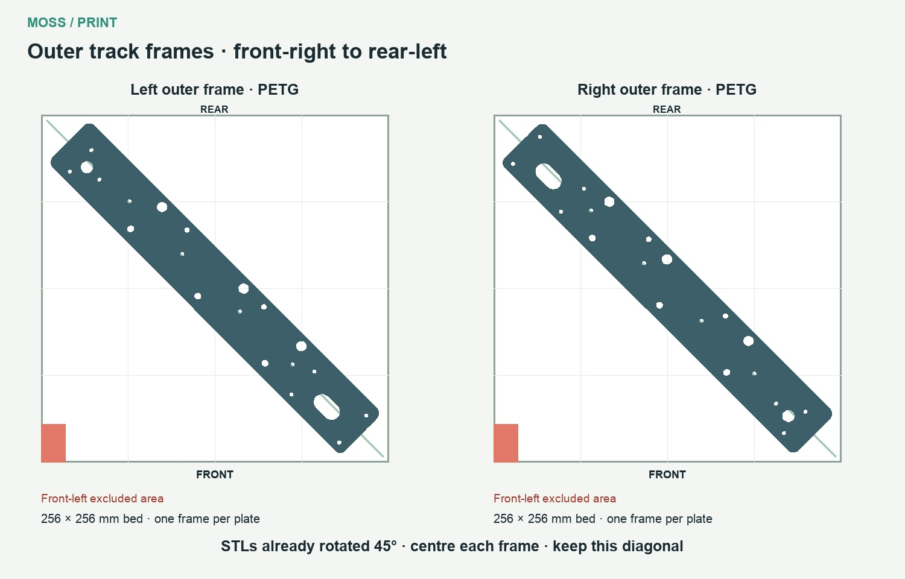

# Outer track frames: diagonal placement

Print each outer frame separately, flat on the plate, along the **front-right to rear-left diagonal**. The supplied left and right STL files are already rotated 45 degrees; keep that rotation and centre the part.

On a P1S, this direction avoids the excluded area at the **front-left** corner. The actual part footprint is approximately **242 × 242 mm**, with at least **6.8 mm** clearance to the bed edges when centred on the 256 × 256 mm plate. This check covers the part itself; verify any brim or skirt in the slicer preview.

Use **PETG**, the standard/default profile and **15% gyroid infill**.

- [Left outer frame](https://github.com/metrox-eth/moss/releases/download/v0.6-r92/Left_Outer_Track_Frame_R32.stl)
- [Right outer frame](https://github.com/metrox-eth/moss/releases/download/v0.6-r92/Right_Outer_Track_Frame_R32.stl)
