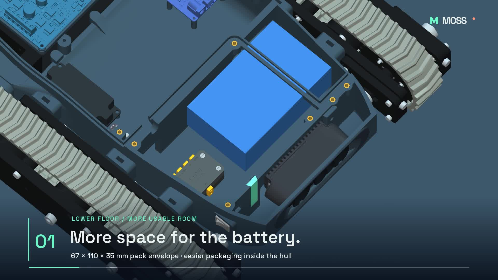
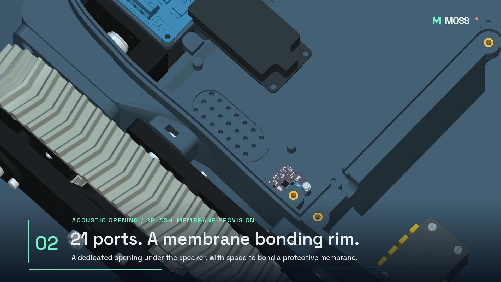
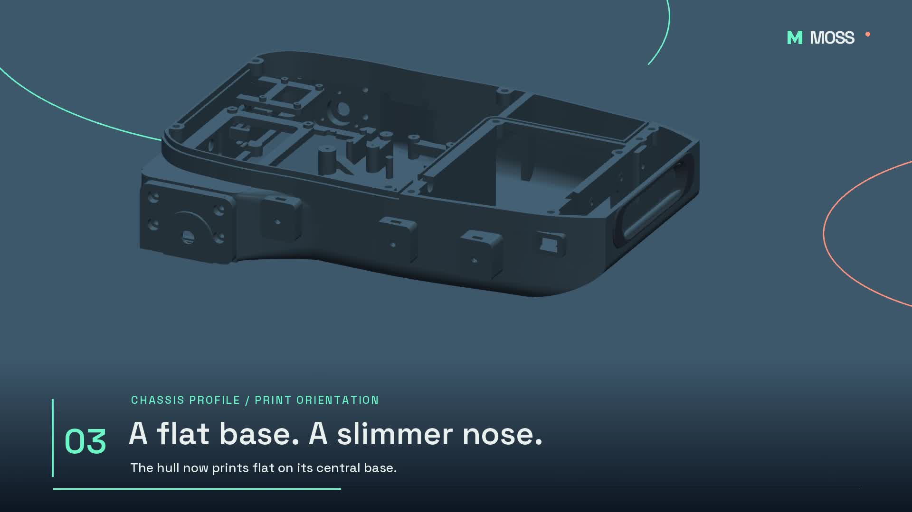
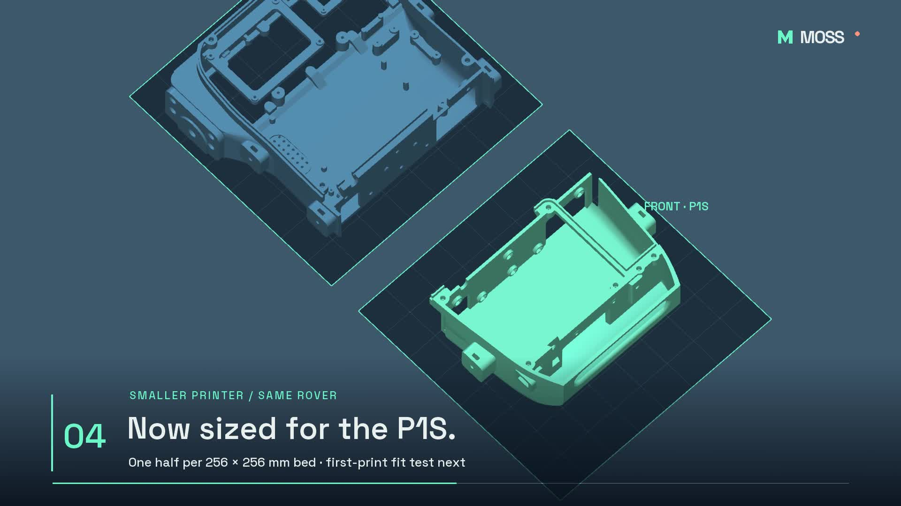
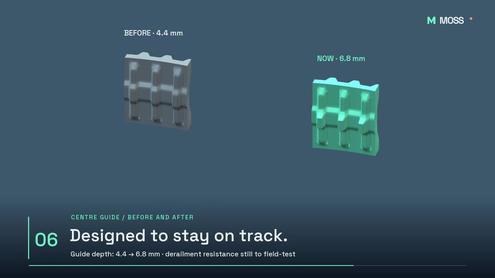
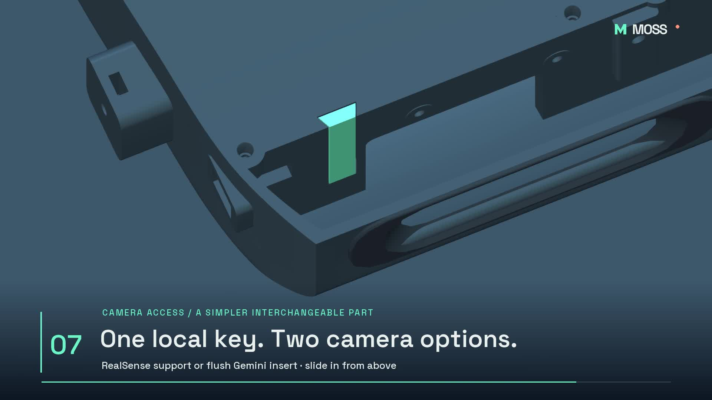

# CAD development with Codex - October 2026

These renders document the current MOSS mechanical development, led by Laurent Genoud with OpenAI Codex. They are views of the working CAD, not photographs of validated printed parts.

Laurent defines the design, assembles and tests the physical rover, and marks up screenshots with changes. Codex helps implement those changes in Fusion, inspect geometry, prepare STL exports, and produce renders and technical notes. This update documents that collaboration with concrete examples.

The full CAD and manufacturing files will follow the project's design freeze and physical tests. This gallery contains images only.

## More room for the battery

The floor was lowered to make room for a 67 × 110 × 35 mm battery envelope. This is packaging space, not a claim about battery capacity or runtime. The battery shown is a placeholder.

## Audio integrated into the chassis

The speaker faces down, with the amplifier alongside it for shorter wiring. Twenty-one small openings sit beneath the speaker capsule. An internal bonding rim is provided for a future acoustic splash-protection membrane; water resistance has not been tested.

## Flat printing base and slimmer nose

R79 combines a flat central printing base with a slimmer curved nose. The camera mounts and mechanical interfaces were retained while the nose profile was revised. The one-piece hull remains an option for a larger printer.

## A split-hull option for a smaller printer

R80 splits the hull at the battery/computer divider. Six M4 fasteners join the halves, and the middle track mount stays with the motor/computer section. The rear half is 203 × 237 × 66 mm; the front half is 144.5 × 211 × 66 mm. Both fit the planned P1S plate envelopes. The joint tolerances are prepared for a first print and fit test, not yet physically validated.

## Deeper TPU track guides

The centre guides grew from 4.4 to 6.8 mm, retaining nominal clearance with the existing road wheels. This aims to reduce derailment; field testing is still needed. The comparison uses the actual 70-tooth printable track meshes.

## Small interchangeable camera inserts

A small insert slides down from above at the USB-side camera mount. The RealSense version carries the screw support; the Gemini version stays flush to leave room for its USB connection. This is a local interchangeable key, not a complete camera cassette.

## What the checks establish

The work includes geometry and clearance checks, mesh checks for STL exports, and print-envelope checks. Those checks do not establish print strength, waterproofing, cable fit on the real components, or reliable operation on the beach. The next steps are printing, assembly and field testing.

The current mechanical integration also uses a Cytron MDD10A motor driver and the selected 90:1, 110 rpm motors. These changes are separate from any future custom electronics board.

## Attribution

MOSS design direction and physical development: Laurent Genoud. CAD iteration, geometry checks, export preparation and this gallery: developed with OpenAI Codex under Laurent's direction. This records the tool's contribution without presenting it as a human collaborator or claiming endorsement.

The SO-101 arm and NormaCore-derived gripper retain their upstream attribution; see [NOTICE](../NOTICE). Documentation and gallery media follow the repository's CC BY 4.0 notice.
