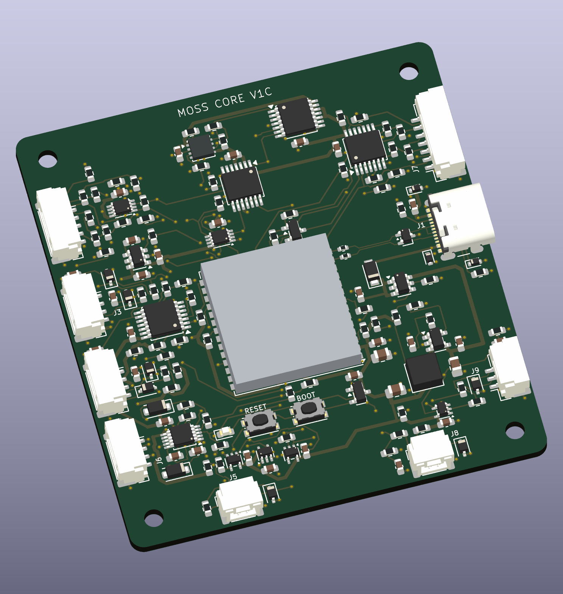

# MOSS Core V1C

**Untested prototype design — 15 October 2026.** Developed and reviewed with Codex. This package supersedes V1B as the prototype candidate.

[Download the complete KiCad and manufacturing package](MOSS_Core_V1C_Audite_20261015.zip) · [SHA-256](MOSS_Core_V1C_Audite_20261015.zip.sha256) · [Schematic PDF](MOSS_Core_V1C_Schematic.pdf) · [Design audit](AUDIT_V1B_V1C.html)

## One control board for MOSS

Core is designed to replace the QT Py, its BFF, the separate INA measurement board and the servo signal adapter. The ESP32-S3 module is soldered directly onto Core; no QT Py or BFF plugs into it.

The Cytron MDD10A, audio amplifier, computer power converter and high-current wiring remain external. Motor and servo power do not pass through this PCB.

Four copper layers, **60 × 65 × 1.6 mm**, four Ø2.7 mm corner holes for M2.5 screws, 52 × 57 mm mounting pitch.

## Inside the ZIP

- Editable KiCad 10.0.6 project, eight schematic sheets and routed PCB.
- Local symbol/footprint libraries and 3D models.
- Gerbers, PTH/NPTH drills, BOM and placement/assembly files.
- Connector pinout, STEP model, design audit and verification reports/scripts.
- Firmware pin contract and porting notes; these are **not executable firmware**.
- Proposed mounting interface; the included lower carrier is for bench use only.

Extract the full ZIP before opening the KiCad project. Its SHA256SUMS.txt covers the delivered files. No complete rover CAD is included.

## Verification and remaining work

Static checks: **0 ERC/DRC violations, 0 unconnected items, 0 schematic/PCB parity issues** under the recorded rules. The review compared 486 physical pin assignments and tested 16,384 stable-state logic combinations. These checks do not establish physical performance.

No board has been fabricated or tested. Manufacturer stackup/USB impedance review, firmware porting, host USB/audio integration, printed attachments and physical bring-up remain outstanding. Read [the fabrication notes](LIRE_AVANT_FABRICATION.txt) before ordering. Download the HTML audit to view its formatted pages.

Hardware design: [CERN-OHL-S-2.0](../../../LICENSE-HARDWARE). Bundled KiCad library material retains its upstream license and exception, included in the ZIP. See [NOTICE](../../../NOTICE) for code, documentation and media licensing.
