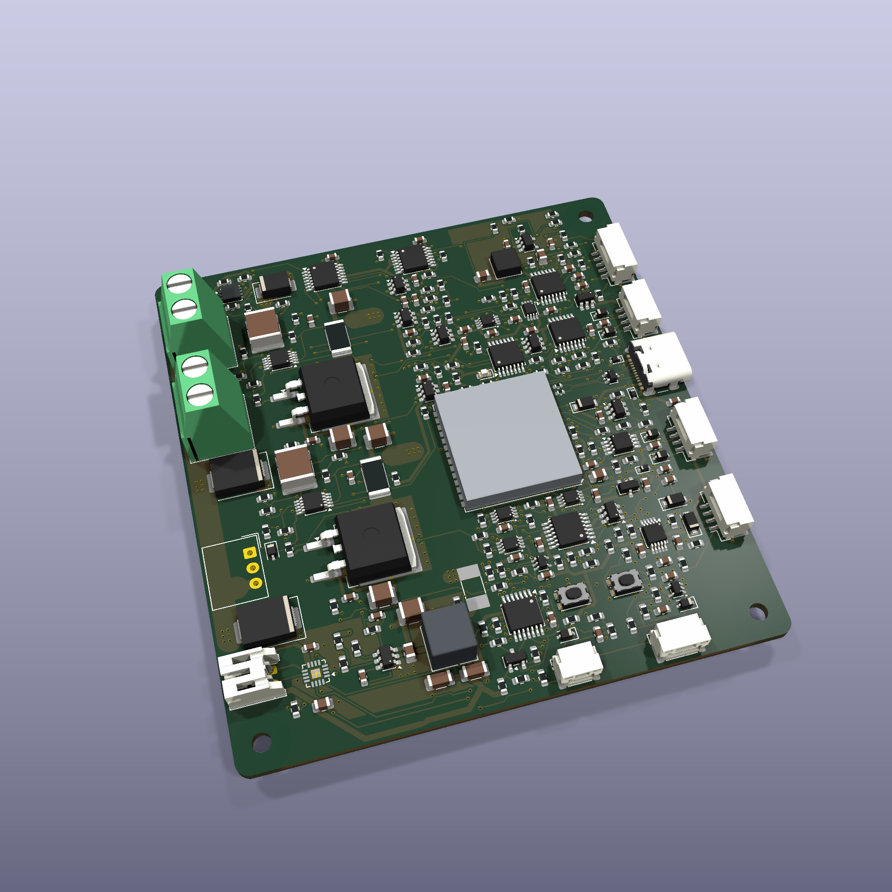
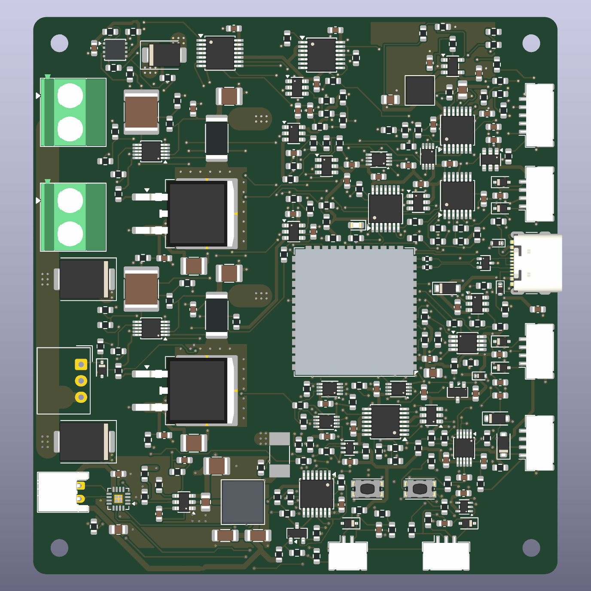
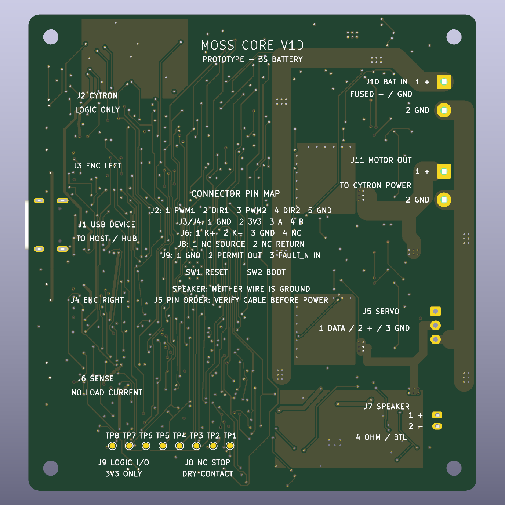

# MOSS Core V1D — routed design review

**DRAFT — NOT FOR FABRICATION OR ASSEMBLY ORDER.** This is an untested prototype design, published for review. Routing is complete; manufacturing release, rover fit, firmware implementation and hardware qualification are still pending.

**V1C — DO NOT FABRICATE:** the earlier V1C package has an incorrect SN74LVC2G08 second-gate physical-pin assignment in U10/U11. A clean ERC/DRC did not detect it. See the [critical erratum](V1C_CRITICAL_ERRATA.txt). The historical archive remains available for traceability.

*Native KiCad rendering of the routed draft. J5, U23 and F2 have no available 3D model in this preview; the ESP32 and watchdog use simplified envelopes. This image does not validate mechanical fit. See [preview notes](3D_PREVIEW_NOTES.json).*

## Download and inspect

- [Complete editable KiCad design and review package](MOSS_Core_V1D_Routed_DRAFT_Review_20261015.zip)
- [Archive SHA-256](MOSS_Core_V1D_Routed_DRAFT_Review_20261015.zip.sha256)
- [Schematic PDF](MOSS_Core_V1D_DRAFT_Schematic.pdf)
- [Working BOM — not an order BOM](BOM_WORKING_NOT_FOR_ORDER.csv)
- [Connector guide](CONNECTOR_GUIDE.txt)
- [Routing status and exact design hashes](PCB_WORKING_STATUS.json)

The full design is in `Integrated_Design/` inside the archive. Local symbols, footprints, available 3D models, static review evidence and the firmware porting contract are included. `Audio_Stage/` is an earlier subcircuit, not the complete board. The firmware folder contains a porting contract, not operational V1D firmware.

## What changed from V1C

- Separate hardware-controlled motor and servo power switches, downstream voltage monitoring, latched rail-loss faults and explicit re-arm behavior.
- A powered three-pin serial-servo connector with half-duplex data buffers; the existing servo daisy chain is retained.
- An integrated MAX98357A mono amplifier and battery-to-audio converter, with a PH2 speaker connector for the confirmed 4-ohm, 3 W speaker.
- Inhibition of all four Cytron PWM/DIR inputs when motor power is invalid, plus the corrected V1C logic pin mapping.
- A larger 80 × 85 mm, four-layer PCB, with four M2.5 mounting holes and 254 assembled components. Rover clearance has not been validated.

The Cytron MDD10A remains external. The external USB hub and host-computer power converter also remain separate; this board is one USB peripheral, not an integrated USB hub or a replacement motor driver.

## Evidence and remaining work

The delivered native DRC reports zero violations, zero missing connections and zero schematic/PCB parity issues under the recorded project rules. These are static checks, not proof that a powered board works. The archive preserves the exact board hashes, review scope, ignored checks and remaining geometric findings.

Before fabrication, review the return/decoupling findings, stackup, power and thermal assumptions, connector mating and physical integration. The current design assumes approximately **8.1 A total for the motor branch** and **2.5 A for the servo chain**; these are design assumptions, not measured performance guarantees. Regeneration/BMS behavior, startup loads, audio limiting and the V1D firmware still require validation before powered actuator tests.

No manufacturing approval is provided by this publication. Planned initial quantity is two assembled prototypes after the required release checks.

Hardware design: [CERN-OHL-S-2.0](../../../LICENSE-HARDWARE). Bundled KiCad library material retains its upstream license and exception, included in the ZIP. See [NOTICE](../../../NOTICE) for repository licensing.

## Package provenance

Published from the 2026-10-15 routed review snapshot. The PCB, schematic and library bytes are unchanged. An editor lock file was omitted, publication-status text was corrected, existing repository/upstream license notices were included, and the file manifest was regenerated. Historical evidence retains its original scope and may include local provenance paths.
